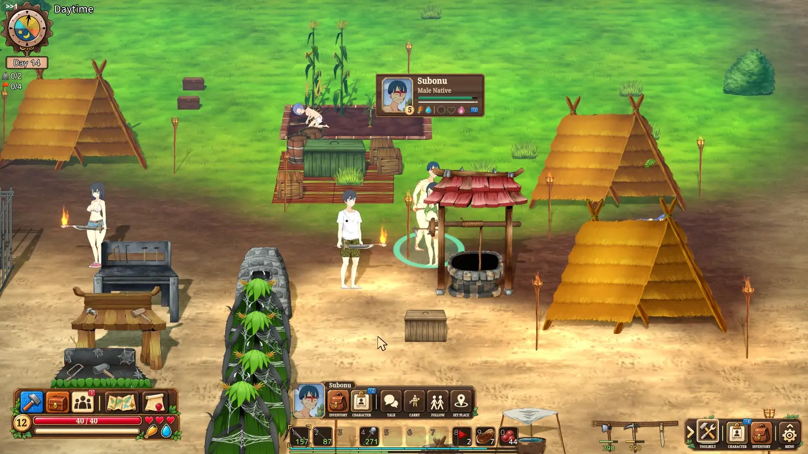
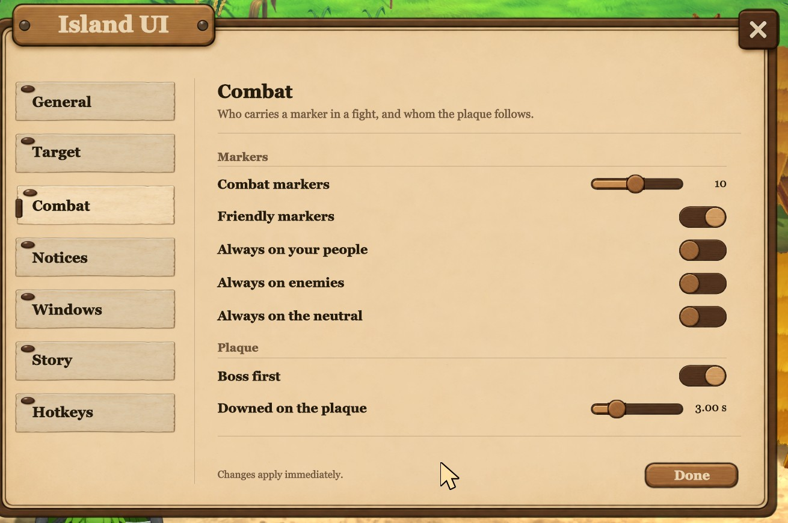

# Island UI

**Deine Insel, auf einen Blick.**

[English](README.md) · [简体中文](README.zh-CN.md) · [日本語](README.ja.md) · [Русский](README.ru.md) · [Português (Brasil)](README.pt-BR.md) · [Español](README.es.md) · **Deutsch**

<sub>Diese Seite ist maschinell übersetzt; maßgeblich ist die englische Fassung.</sub>



**Nicht tausend Pflaster.** Island UI tritt einen Schritt zurück und schreibt die Oberfläche von Mad Island von Grund auf neu: den Bildschirm, das Anvisieren und alles, was daraus folgt. Es baut auf ein paar Ideen auf - ein Platz auf dem Bildschirm für dich, für das, was um dich herum ist, und für das, womit du gerade zu tun hast, und ein Ziel, das alles verbindet - und daraus sind [alle Funktionen (derzeit 202) →](FEATURES.md) gewachsen.

Für die Insel gemacht, tritt es zur Seite und lässt dich **spielen**: Was du wissen musst, steht dort, wo du hinschaust, was du tun willst, ist einen Handgriff entfernt, und die sonst verborgenen Regeln des Spiels kommen ans Licht.

## Was es macht

- **[Deins bleibt deins.](SHOWCASE.md#yours-is-always-yours)** Du rechts, das, womit du zu tun hast, in der Mitte, deine Umgebung links. Ein Gegenstand wird immer an dir benutzt; um ihn jemandem zu geben, lässt du ihn auf die Person fallen.
- **[Ein Ziel, das bleibt.](SHOWCASE.md#a-target)** `Tab` wählt die Person oder das Ding, mit dem du zu tun hast, ohne hinzulaufen, und hält es, bis du loslässt, mit einer Leiste aller Dinge, die du damit tun kannst.
- **[Ein Dorf, keine Zahlenliste.](SHOWCASE.md#your-village)** Die Bewohnerliste zeigt, wer unglücklich ist, das Blatt sagt warum, und ein Knopf bringt dich zur Lösung.
- **[Schluss mit dem Hin- und Herschieben.](SHOWCASE.md#no-more-item-juggling)** Jeder Speicher in Reichweite in einem Fenster, und das Herstellen nimmt aus deinen Taschen und allem um dich herum.
- **[Der ganze Kampf.](SHOWCASE.md#the-whole-fight)** Wer dabei ist, wer dich angreift und wer von außerhalb des Bildschirms kommt.
- **[Jede Zahl sagt, warum.](SHOWCASE.md#on-top)** Wie man jeden Gegenstand bekommt, wohin eine Entscheidung in der Geschichte führt, die Regel hinter jeder Zahl - in sieben Sprachen.

**[Im Spiel ansehen, mit Videos →](SHOWCASE.md)** · **[Alle Funktionen, groß und klein →](FEATURES.md)** (auf Englisch)

## Installation

Lade `Island-UI-vX.Y.Z-installer.zip` unter [Releases](../../releases) herunter, entpacke es irgendwohin und doppelklicke `install.bat`. Es findet das Spiel über Steam, fügt BepInEx nur hinzu, wenn das Spiel es noch nicht hat, und kopiert die Mod hinein. `uninstall.bat` entfernt sie wieder.

<details><summary><b>Andere Downloads, und Deinstallation von Hand</b></summary>

| Download | Für wen |
|---|---|
| `Island-UI-vX.Y.Z-installer.zip` | **Am einfachsten.** Der Installer oben. Er rührt keine anderen Mods oder Einstellungen an und lädt nichts herunter. |
| `Island-UI-vX.Y.Z-with-Island-Ex-installer.zip` | Derselbe Installer, mit Island Ex dazu. |
| `Island-UI-vX.Y.Z-with-BepInEx.zip` | Ohne Installer: in den Spielordner entpacken (neben `Mad Island.exe`). Bringt BepInEx 5.4.23.5 mit. |
| `Island-UI-vX.Y.Z.zip` | Du hast BepInEx 5 schon: in den Spielordner entpacken. |
| `Island-Ex-vX.Y.Z.zip` | Nur Island Ex: in den Spielordner entpacken. Braucht BepInEx 5. |

Der Spielordner ist meist `C:\Program Files (x86)\Steam\steamapps\common\Mad Island` (in Steam: Rechtsklick auf das Spiel, *Verwalten*, *Lokale Dateien durchsuchen*). Windows warnt eventuell vor dem Ausführen eines heruntergeladenen Skripts; der Installer ist reiner Text und liegt in [`installer/`](installer).

Zum Deinstallieren von Hand löschst du `BepInEx/plugins/IslandUI` und `BepInEx/plugins/islandui-art` (und `BepInEx/plugins/IslandEx` für Island Ex).

</details>

## Einstellungen

Das Menü des Spiels hat unter *Option* einen Eintrag **Island UI**. Änderungen wirken sofort. Die Mod folgt der Sprache des Spiels oder der, die du wählst: Englisch, vereinfachtes Chinesisch, Japanisch, Russisch, brasilianisches Portugiesisch, Spanisch oder Deutsch.

<details><summary><b>Die Seiten, die Übersetzungen und die Konfigurationsdatei</b></summary>

Die Seiten sind in Gruppen geordnet: Allgemein (dein Zeiger und die Sprache), Ziel, Kampf, Hinweise, Fenster, Geschichte und Tasten. **Island Ex** bekommt einen eigenen Eintrag, solange es installiert ist.



Die Übersetzungen sind maschinell erstellt, Korrekturen sind also willkommen: Öffne ein Issue, oder bearbeite `BepInEx/plugins/IslandUI/Localization/<language>/strings.txt` (und `item-guide.tsv`, `story-choices.tsv`) und schick es ein. Der Kopf jeder Datei erklärt, wie.

Die größeren Teile abschalten (das Umgebungsfenster, die Aktionsleiste, das Zielfeld, die Bewohnerliste, die Charakterblätter) geht in `BepInEx/config/madisland.islandui.cfg`.

Die Symbole der Mods unten links auf dem Titelbildschirm zeigen, dass sie geladen sind; fahr mit der Maus darüber für die Version, klick darauf, um die Mod aus- oder einzuschalten.

</details>

## Island Ex


Island UI hält sich an die Regeln des Spiels: Es ändert, wie du das Spiel siehst und wie du hinkommst, nie, was du tun kannst. Änderungen an den Regeln stecken in einer kleinen, eigenen Mod, Island Ex, im selben Release. Island UI braucht sie nicht.

<details><summary><b>Was Island Ex macht</b></summary>

- **Effektfilter**: Schalte jeden visuellen Effekt ab, den du lieber nicht sehen willst.
- **Halten zum Wehren**: Im Griff schlägt das Halten der Angriffstaste weiter zu.
- **Bleibt auf dem Bildschirm**: Das Spiel minimiert sich nicht mehr bei Alt+Tab oder einem Klick auf einen anderen Monitor.
- **Trocken im Haus**: Regen fällt nicht mehr im Haus.
- **Herauszoomen**: Zieh die Kamera weiter zurück, als das Spiel erlaubt.
- **Kaputte Werkzeuge behalten**: Ein abgenutztes Werkzeug bleibt kaputt in deiner Tasche, für ein Reparaturset.

</details>

## Einschränkungen

Island UI ist jung. 0.9.0 baut den Großteil der Oberfläche neu und wurde gespielt, nicht ausgiebig getestet: Rechne mit Ecken und Kanten und dem einen oder anderen Fehler. Manche Bildschirme des Spiels selbst sind noch nicht neu gebaut und sehen aus und funktionieren wie immer. Wenn etwas kaputtgeht, hilft ein Issue mit angehängter `BepInEx/LogOutput.log` am meisten.

## Kompatibilität

Getestet auf dem Steam-Zweig `beta_open`, Build 25095856, mit BepInEx 5.4.23.5. Nach einem Spielupdate such in `BepInEx/LogOutput.log` nach `Patch census [IslandUI]: ... all bound.` Steht dort etwas anderes, hat das Update etwas verschoben, und die Mod braucht ein neues Release.

## Quellcode

Jeder Commit hier ist ein Release; die Versions-Tags passen zu den Release-Zips.

<details><summary><b>Der Aufbau, und wie man baut</b></summary>

```
src/IslandUI/    the mod: Inventory/ (the windows, action bar, tool belt, target), Crafting/ and
                 Browser/ (the crafting window), Card/ (item and recipe cards), Model/ (favourites,
                 moods, recipes), QoL/ (keys, quick save), UI/ (controls, cursor, console, map),
                 Data/ (the item guide and story hints, as tables)
src/IslandEx/    Island Ex: one file per feature
src/Shared/      linked into both DLLs: PatchCensus.cs applies the Harmony patches one class at
                 a time and logs any that no longer bind; TitleBadge.cs is the title-screen icon
art/             the interface's art, shipped as islandui-art
installer/       the install.bat / install.ps1 shipped in the installer downloads
```

Zum Bauen brauchst du das .NET SDK und das installierte Spiel (die Projekte verweisen auf seine DLLs):

```
dotnet build src/IslandUI/IslandUI.csproj -c Release
dotnet build src/IslandEx/IslandEx.csproj -c Release
```

Ein Build kopiert die DLL in das `BepInEx/plugins` des Spiels; füg `-p:GameDir="D:\...\Mad Island"` für ein Spiel an anderer Stelle hinzu, oder `-p:NoDeploy=true`, um ohne Kopieren zu bauen. Island UI braucht außerdem `art/*.png` in `BepInEx/plugins/islandui-art`.

</details>

## Kontakt

Fehler, Ideen, oder möchtest du etwas wiederverwenden? [Öffne ein Issue](../../issues), schreib an [maliekee@pm.me](mailto:maliekee@pm.me) oder finde mich auf [Discord](https://discord.com/users/1523362502224777439).
