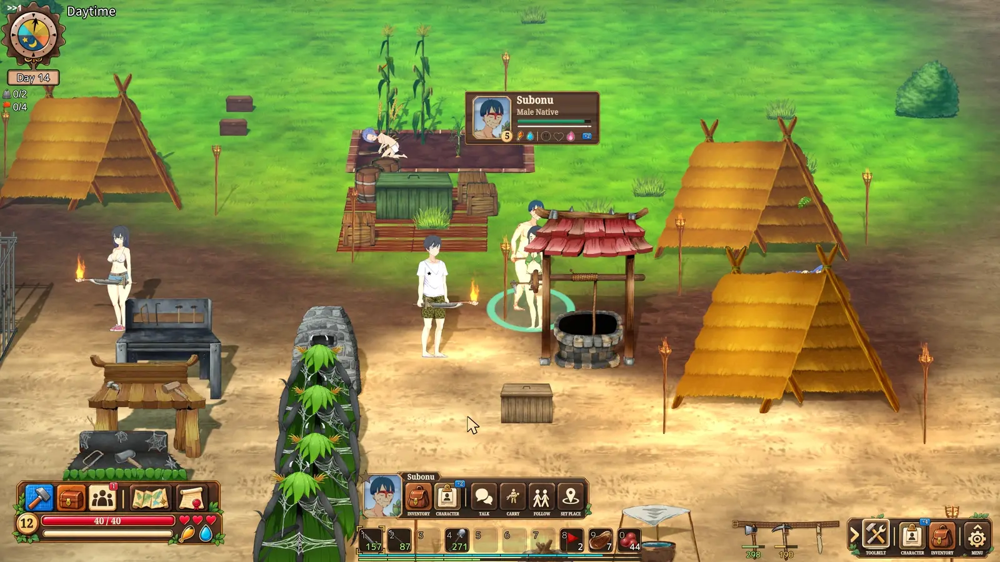
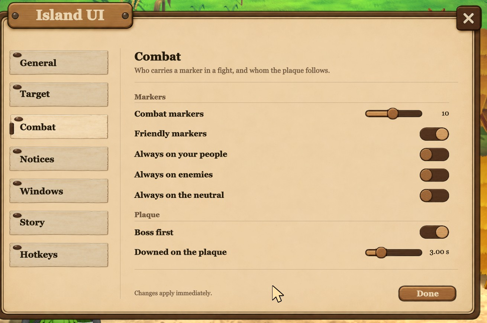

# Island UI

**Tu isla, a la vista.**

[English](README.md) · [简体中文](README.zh-CN.md) · [日本語](README.ja.md) · [Русский](README.ru.md) · [Português (Brasil)](README.pt-BR.md) · **Español** · [Deutsch](README.de.md)

<sub>Esta página está traducida por máquina; la versión en inglés es la que manda.</sub>



**Una interfaz coherente y cuidada al detalle para Mad Island.** Se apoya en unos pocos principios, y cada una de sus [200 funciones →](FEATURES.md) nace de ellos:

- **[Construida desde cero.](SHOWCASE.md#built-from-the-ground-up)** No son mil tiritas. Island UI da un paso atrás y rehace la interfaz por completo, del concepto al código.
- **[Sale solo.](SHOWCASE.md#second-nature)** Todo se presenta como la gente asimila las cosas de forma natural, así que nada necesita explicación. Los objetos vuelan hacia ti al recogerlos, y las estadísticas muestran lo que significan en lugar de ser simples números.
- **[Jugar, no hacer papeleo.](SHOWCASE.md#play-not-paperwork)** Las tareas pesadas se quitan de en medio. Tu hacha aparece cuando golpeas un árbol, bebes en el pozo sin hacer clic, y con una sola pulsación vacías en tus bolsas todos los cofres de alrededor.
- **[Un solo trabajo.](SHOWCASE.md#one-job)** Island UI es un proyecto grande con un objetivo concreto: la interfaz. Se mantiene a propósito en su carril, para no estorbar al contenido del juego ni a tus otros mods. Sus comodidades respetan el espíritu del juego, y los ajustes que cambian las reglas están en Island Ex.

Esto es un trabajo hecho con cariño, y quiero que sea realmente bueno. Me encantaría saber qué piensas, así que escríbeme por [Discord](https://discord.com/users/1523362502224777439) o [abre una incidencia aquí](../../issues).

**[Míralo en juego, con vídeos →](SHOWCASE.md)**

## Instalación

Descarga `Island-UI-vX.Y.Z-installer.zip` desde [Releases](../../releases), extráelo donde quieras y haz doble clic en `install.bat`. Encuentra el juego a través de Steam, añade BepInEx solo si el juego aún no lo tiene y copia el mod. `uninstall.bat` lo vuelve a quitar.

<details><summary><b>Otras descargas, y desinstalar a mano</b></summary>

| Descarga | Para quién |
|---|---|
| `Island-UI-vX.Y.Z-installer.zip` | **Lo más fácil.** El instalador de arriba. No toca otros mods ni ajustes, y no descarga nada. |
| `Island-UI-vX.Y.Z-with-Island-Ex-installer.zip` | El mismo instalador, también con Island Ex. |
| `Island-UI-vX.Y.Z-with-BepInEx.zip` | Sin instalador: extráelo en la carpeta del juego (junto a `Mad Island.exe`). Trae BepInEx 5.4.23.5. |
| `Island-UI-vX.Y.Z.zip` | Ya tienes BepInEx 5: extráelo en la carpeta del juego. |
| `Island-Ex-vX.Y.Z.zip` | Solo Island Ex: extráelo en la carpeta del juego. Necesita BepInEx 5. |

La carpeta del juego suele ser `C:\Program Files (x86)\Steam\steamapps\common\Mad Island` (en Steam: clic derecho en el juego, *Administrar*, *Ver archivos locales*). Windows puede avisar al ejecutar un script descargado; el instalador es texto plano y está en [`installer/`](installer).

Para desinstalar a mano, borra `BepInEx/plugins/IslandUI` y `BepInEx/plugins/islandui-art` (y `BepInEx/plugins/IslandEx` para Island Ex).

</details>

## Ajustes

El menú del juego tiene una entrada **Island UI** debajo de *Option*. Los cambios se aplican al momento. El mod sigue el idioma del juego, o el que elijas: inglés, chino simplificado, japonés, ruso, portugués de Brasil, español o alemán.

<details><summary><b>Las páginas, las traducciones y el archivo de configuración</b></summary>

Las páginas van en grupos: General (tu puntero y el idioma), Objetivo, Combate, Avisos, Ventanas, Historia y Atajos. **Island Ex** tiene su propia entrada mientras esté instalado.



Las traducciones están hechas por máquina, así que las correcciones son bienvenidas: abre una issue, o edita `BepInEx/plugins/IslandUI/Localization/<language>/strings.txt` (y `item-guide.tsv`, `story-choices.tsv`) y envíalo. La cabecera de cada archivo explica cómo.

Desactivar las piezas grandes (la ventana de alrededores, la barra de acciones, el panel del objetivo, la lista de aldeanos, las fichas de personaje) se hace en `BepInEx/config/madisland.islandui.cfg`.

Los iconos de los mods en la esquina inferior izquierda de la pantalla de título indican que se han cargado; pasa el ratón por encima para ver la versión, haz clic para desactivar o activar el mod.

</details>

## Island Ex


Island UI juega según las reglas del juego: cambia cómo ves el juego y cómo llegas a las cosas, nunca lo que puedes hacer. Los ajustes que cambian las reglas viven en un mod pequeño y aparte, Island Ex, en la misma versión. Island UI no lo necesita.

<details><summary><b>Qué hace Island Ex</b></summary>

- **Filtro de efectos**: desactiva cualquier efecto visual que prefieras no ver.
- **Mantener para forcejear**: en un agarre, mantener el botón de ataque sigue golpeando.
- **Se queda en pantalla**: el juego ya no se minimiza con Alt+Tab ni al hacer clic en otro monitor.
- **Seco bajo techo**: la lluvia ya no cae dentro de las casas.
- **Alejar la cámara**: aleja la cámara más de lo que permite el juego.
- **Conservar herramientas rotas**: una herramienta gastada se queda en tu bolsa, rota, a la espera de un kit de reparación.

</details>

## Limitaciones

Island UI es joven. La 0.9 rehace la mayor parte de la interfaz y se ha jugado, no probado a fondo: espera asperezas y algún error suelto. Algunas pantallas propias del juego aún no están rehechas y se ven y funcionan como siempre. Si algo se rompe, una issue con tu `BepInEx/LogOutput.log` adjunto es lo que más ayuda.

Probado en la rama `beta_open` de Steam, build 25095856, con BepInEx 5.4.23.5. Tras una actualización del juego, busca en `BepInEx/LogOutput.log` la línea `Patch census [IslandUI]: ... all bound.` Si dice otra cosa, la actualización ha movido algo y el mod necesita una nueva versión.

## Código fuente

Cada commit aquí es una versión; las etiquetas de versión coinciden con los zips publicados.

<details><summary><b>Cómo compilar</b></summary>

Para compilar necesitas el .NET SDK y el juego instalado (los proyectos hacen referencia a sus DLL):

```
dotnet build src/IslandUI/IslandUI.csproj -c Release
dotnet build src/IslandEx/IslandEx.csproj -c Release
```

Al compilar se copia la DLL en el `BepInEx/plugins` del juego; añade `-p:GameDir="D:\...\Mad Island"` si el juego está en otro sitio, o `-p:NoDeploy=true` para compilar sin copiar. Island UI también necesita `art/*.png` en `BepInEx/plugins/islandui-art`.

</details>

## Contacto

¿Errores, ideas, o quieres reutilizar algo? [Abre una issue](../../issues), escribe a [maliekee@pm.me](mailto:maliekee@pm.me) o búscame en [Discord](https://discord.com/users/1523362502224777439).

## Gracias por vuestra participación y apoyo

h1sagi, NoobInDaHause, Ramiyak, Ex0du5_2169, Dimastrelok, Yuuto, Cosmo, Abyss, NotTeaBut, Kringe, Kestraz
