# Island UI

**A rework of Mad Island's interface.**

Island UI is a BepInEx mod that rebuilds
nearly every screen you use while playing: the inventory, chests, crafting, the character
sheets, the friends list, the bar at the bottom of the screen, the console and the settings.
Every one is new in how it looks and in how it works: one wooden, hand-labelled style
throughout, and screens rethought to work together.

It also changes how the game plays from minute to minute: how you pick things up, store
them, craft, reach for your tools and choose a target. What you can craft, carry or do stays
the game's own. Island UI changes how you get there.

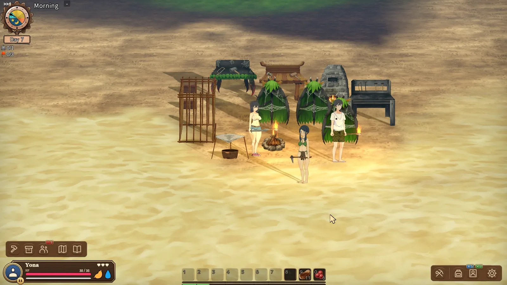

In the base game, loadouts, bags and character sheets, yours and those of whoever you deal
with, share the same few panels, so one panel can show you one moment and them the next.
Island UI gives each its own place and keeps it there:
on the **left** what is around you (crafting, the storage nearby, your people), in the
**middle** what you are dealing with (the person or thing you target, above the action
bar), on the **right** you (your bags, your character, your tools). Your own things never
give way to someone else's.

## Every chest at once

<table>
<tr>
<td width="40%">

The vicinity window (`V`) lists all the storage within reach: chests, material storages,
cages, traps, planters, your people's bags and bodies. **All in**, **Stack** and **All out**
work on every one of them at once, and you see the items fly.

</td>
<td>

<!-- clip 01-hero-all-out-all-in -->
https://github.com/user-attachments/assets/12e0189e-9e86-4b81-9ac5-90893dd94725

</td>
</tr>
<tr>
<td width="40%">

The list follows you: walk into the base and the storages join it, walk off and they drop out.

</td>
<td>

<!-- clip 02-vicinity-walk-v2 -->
https://github.com/user-attachments/assets/590bbbd8-7461-4dd5-8974-cb22c862aab5

</td>
</tr>
</table>

## Crafting from what is around you

<table>
<tr>
<td width="40%">

The crafting window (`C`) shows your own recipes and those of every workbench in reach,
grouped by bench. Materials count from your bags and the storage nearby. A missing
material is one click from its own recipe, and back.

</td>
<td>

<!-- clip 11-blueprint-sub-recipe -->
https://github.com/user-attachments/assets/d7985c82-1aa1-434d-b85b-8ed02da8286a

</td>
</tr>
</table>

## Pickups land where you can see them

<table>
<tr>
<td width="40%">

Loot fills your own bag as well as the Shared Bag, topping up stacks first, and each pickup
flies into the slot it landed in.

</td>
<td>

<!-- clip 05-pickup-flights-v3 -->
https://github.com/user-attachments/assets/0849319c-b034-418c-b20f-7e249fc9da82

</td>
</tr>
</table>

## An action bar for both hands

<table>
<tr>
<td width="40%">

The bar on `1`–`0` holds what an item *does*: a weapon, a shield or a torch for the off
hand, meat to eat. Press a key and it is in your hand, gold brackets mark what you hold,
and the item itself stays in your bag.

</td>
<td>

<!-- clip 23-action-bar-hands -->
https://github.com/user-attachments/assets/d0fac9b8-3178-46b8-a164-d2a176950df0

</td>
</tr>
</table>

## Your people at a glance

The roster replaces the friends list: everyone you employ, wherever they are, sorted by
kind, state or mood, with what is wrong written on each row.

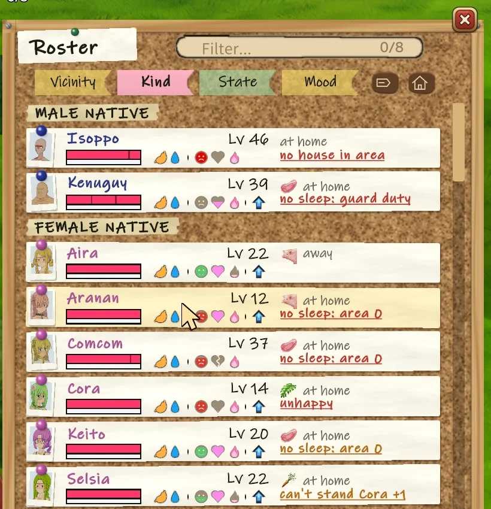

Character sheets replace the status window: a printed form in a folder, with points to
spend marked. On the Social tab, a villager's sheet lists every cause of their mood, warns
of a grudge before it costs anything, and says how to fix it. On the map, every villager is
a pin in the colour of their mood, with red yarn between two who cannot stand each other.

<p>
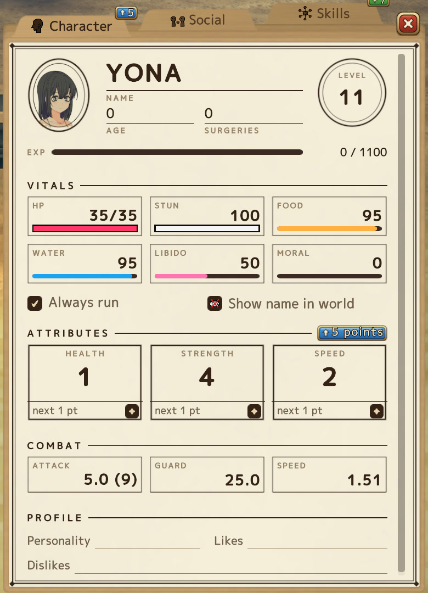
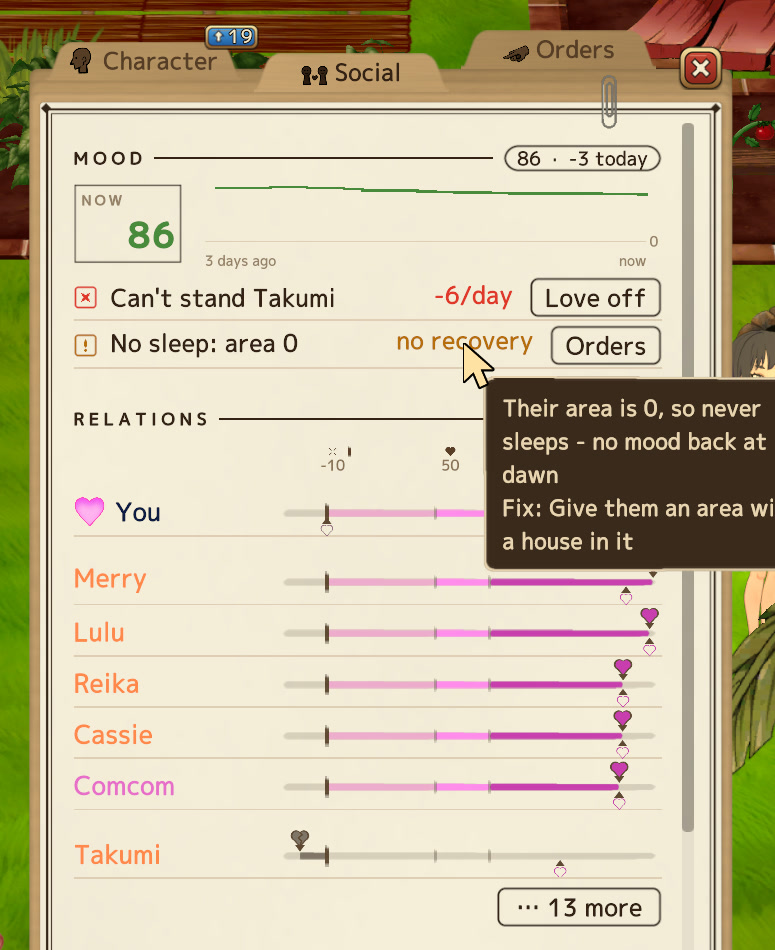
</p>

On the Orders tab you set a follower's combat role and job, and where they stand: following you, or a place of their own with a territory and a combat area.

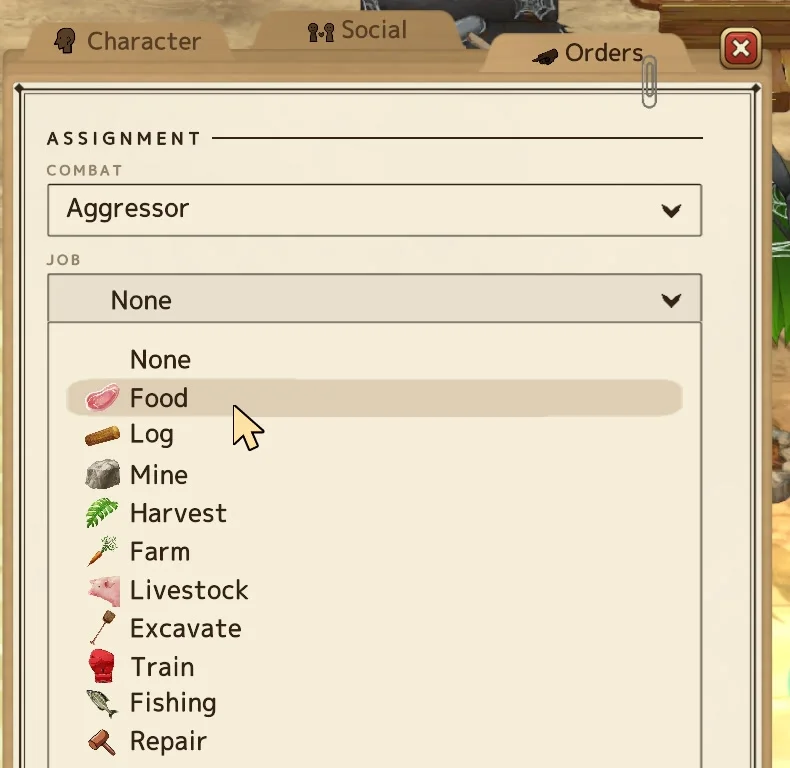

## Targeting, changed a little

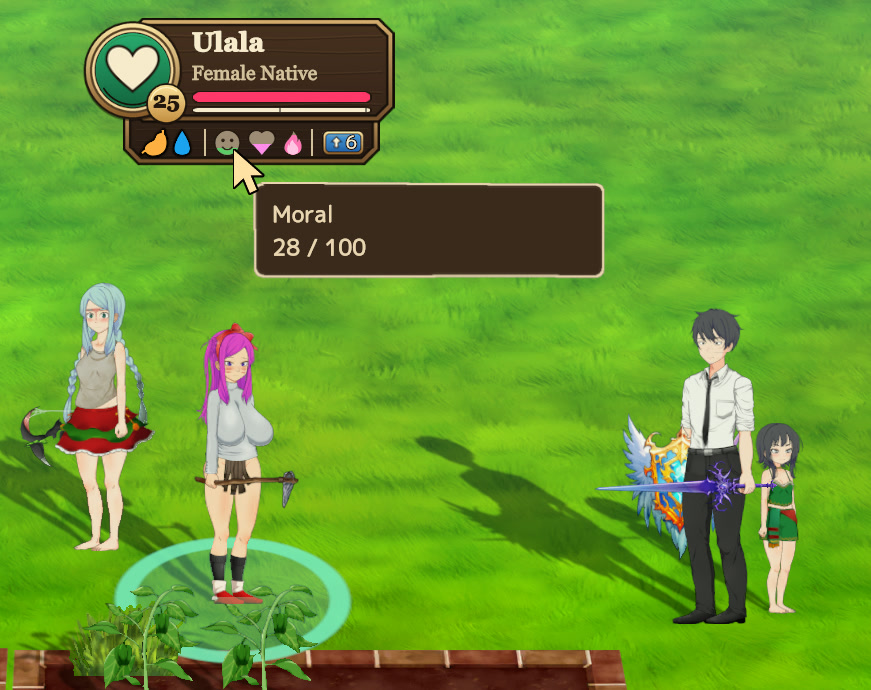

Island UI keeps one target at a time, and it has an opinion on how long it lasts:

- **A click is still the game's**: you walk there and the game opens what it opens. But a
  person you clicked stays your target when you walk on, until you press `Escape`, close
  it, pick something else or go to another area.
- **`Tab` targets without walking**: whatever is nearest the cursor, your people, enemies,
  strangers, bodies, chests and props alike; press again for the next nearest. A chest in
  reach opens from where you stand. `Tab` no longer opens the game's menu (the gear
  button on the dock does), and the key can be changed.
- **The target** wears a badge over its head: name, level, health and needs, each need with
  its value on hover. Buttons for what you can do with it sit above the bar, and a ring on
  the ground marks it: green yours, red hostile, amber a stranger or a thing.

<br clear="right">

## And the rest

- **Your bags** (`B`) as a column of real slots. `Ctrl`+click moves an item across,
  `Shift`+click splits a stack.
- **Favourites** (`Alt`+click) stay with you: All in, Stack and quick stack leave them, and
  they cannot be dropped or put in a chest by mistake. The marks are kept in your save.

  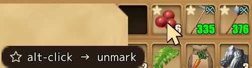

- **A tool belt** with hooks for an axe, a pickaxe and a knife. Chop a tree with a sword in
  hand and the belt's axe comes out for the job, then the sword goes back.

  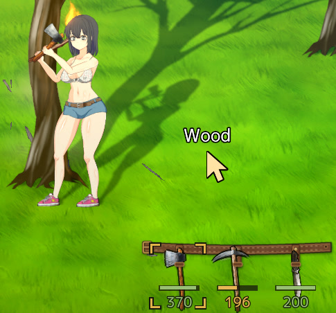
- **Item cards** say where an item is found, what drops it and who trades it.

  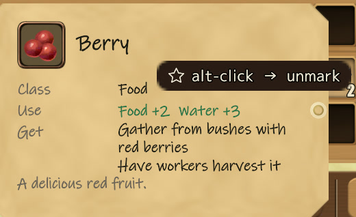

- **Story choices say what they lead to**; spoilers stay hidden until you click them.

  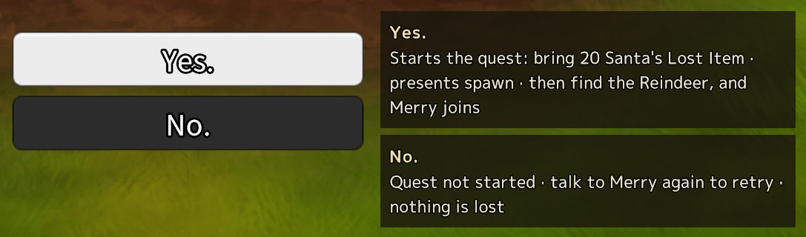
- **A drop-down console** on the key left of `1`: the game's own commands, with Tab completion,
  history and a scrolling log.

  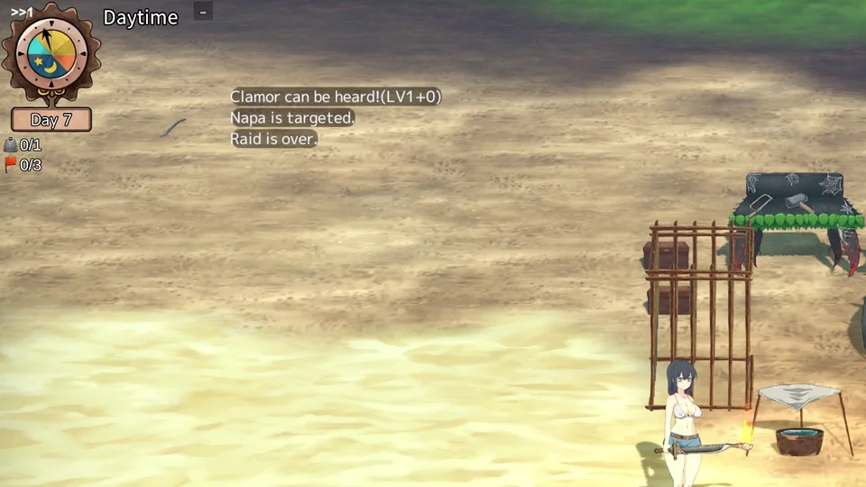

- **Every key rebindable**, quick save on `F6`, a cursor that stays readable on sand (`F7`),
  and `Space` to close every window.

## Island Ex


A separate, small mod in the same release, for tweaks that have nothing to do with the
interface. Island UI does not need it.

- **Effect filter**: switch off any visual effect you would rather not see.
- **Hold to struggle**: in a grapple, holding the attack button keeps hitting.
- **Stay on screen**: the game no longer minimises itself on Alt+Tab or a click on another monitor.
- **Dry indoors**: rain no longer falls inside a house.

## Install

Pick one download from the [Releases](../../releases) page:

| Download | For whom |
|---|---|
| `Island-UI-vX.Y.Z-installer.zip` | **Easiest.** Extract it anywhere and double-click `install.bat`. It finds the game through Steam, adds BepInEx only if the game does not have it yet, and copies the mod in. It does not touch other mods or settings, and downloads nothing. `uninstall.bat` removes the mod again. |
| `Island-UI-vX.Y.Z-with-Island-Ex-installer.zip` | The same installer, with Island Ex as well. |
| `Island-UI-vX.Y.Z-with-BepInEx.zip` | No installer wanted: extract it into the game folder (next to `Mad Island.exe`). Brings BepInEx 5.4.23.5 along. |
| `Island-UI-vX.Y.Z.zip` | You already have BepInEx 5: extract it into the game folder. |
| `Island-Ex-vX.Y.Z.zip` | Island Ex alone: extract it into the game folder. Needs BepInEx 5. |

The game folder is usually `C:\Program Files (x86)\Steam\steamapps\common\Mad Island` (in
Steam: right-click the game, *Manage*, *Browse local files*). Windows may warn about running
a downloaded script; the installer is plain text and lives in [`installer/`](installer).

To uninstall by hand, delete `BepInEx/plugins/IslandUI` and `BepInEx/plugins/islandui-art`
(and `BepInEx/plugins/IslandEx` for Island Ex).

## Settings

The game's menu has an **Island UI** entry below *Option* (and **Island Ex** while that mod
is installed), with pages for the cursor, the target, item cards, story hints and every key.

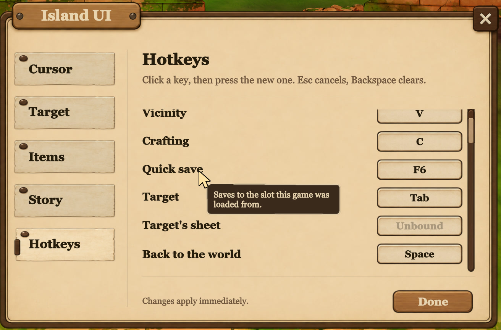

Switching off the larger pieces (the vicinity window, the action bar, the target panel, the
roster, the character sheets) is in `BepInEx/config/madisland.islandui.cfg`.

The mods' icons in the bottom-left of the title screen show that they loaded; hover one for
its version, click it to switch the mod off or on.

## Compatibility

Tested on the Steam `beta_open` branch, build 25095856, with BepInEx 5.4.23.5. After a
game update, look in `BepInEx/LogOutput.log` for `Patch census [IslandUI]: ... all bound.`
If it says anything else, the update moved something and the mod needs a new release.

## Source

Each commit here is one release; the version tags match the release zips.

```
src/IslandUI/    the mod: Inventory/ (the windows, action bar, tool belt, target), Crafting/ and
                 Browser/ (the crafting window), Card/ (item and recipe cards), Model/ (favourites,
                 moods, recipes), QoL/ (keys, quick save), UI/ (controls, cursor, console, map),
                 Data/ (the item guide and story hints, as tables)
src/IslandEx/    Island Ex: one file per feature
src/Shared/      linked into both DLLs: PatchCensus.cs applies the Harmony patches one class at
                 a time and logs any that no longer bind; TitleBadge.cs is the title-screen icon
art/             the interface's art, shipped as islandui-art
installer/       the install.bat / install.ps1 shipped in the installer downloads
```

To build, you need the .NET SDK and the game installed (the projects reference its DLLs):

```
dotnet build src/IslandUI/IslandUI.csproj -c Release
dotnet build src/IslandEx/IslandEx.csproj -c Release
```

A build copies the DLL into the game's `BepInEx/plugins`; add `-p:GameDir="D:\...\Mad Island"`
for a game elsewhere, or `-p:NoDeploy=true` to build without copying. Island UI also needs
`art/*.png` in `BepInEx/plugins/islandui-art`.

## Contact

Bugs, ideas, or want to reuse something? [Open an issue](../../issues), write to
[maliekee@pm.me](mailto:maliekee@pm.me), or find me on [Discord](https://discord.com/users/1523362502224777439).
