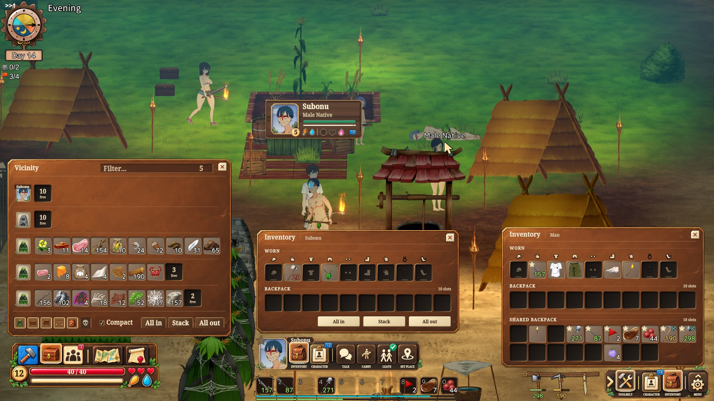
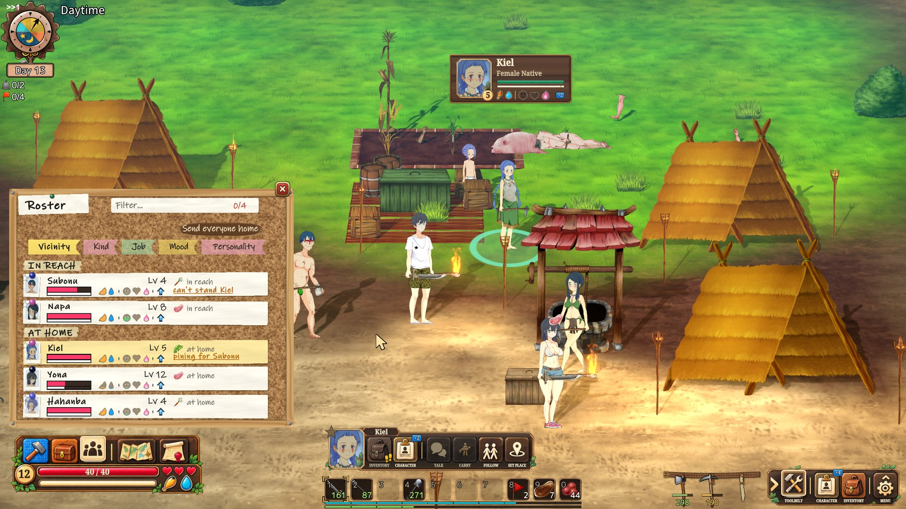
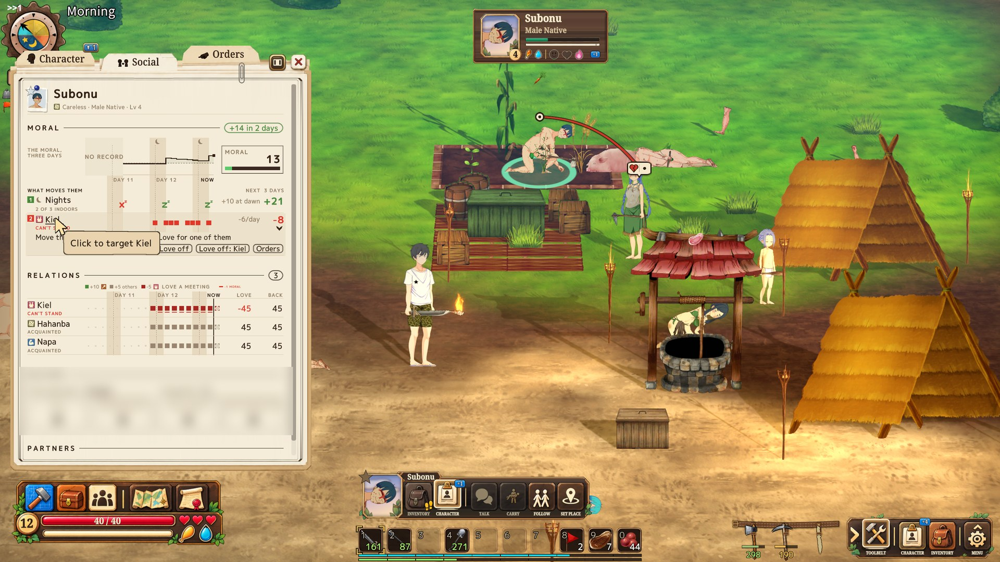
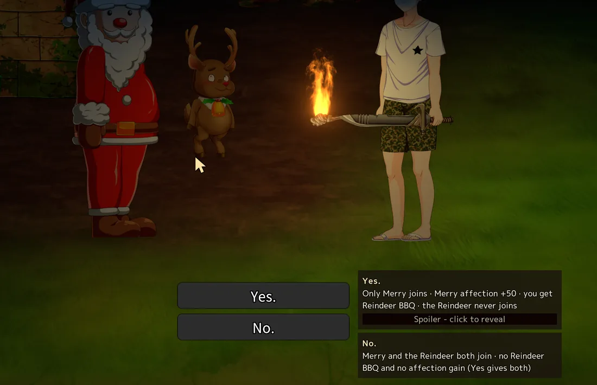
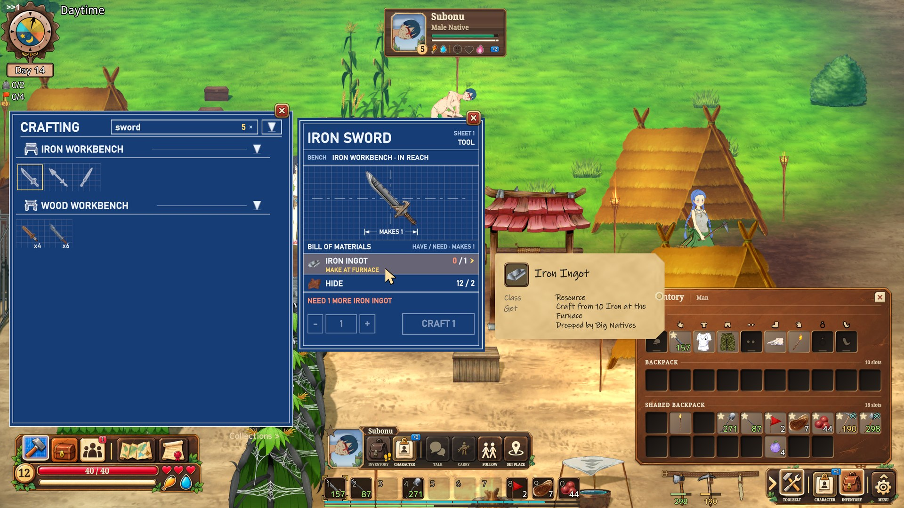
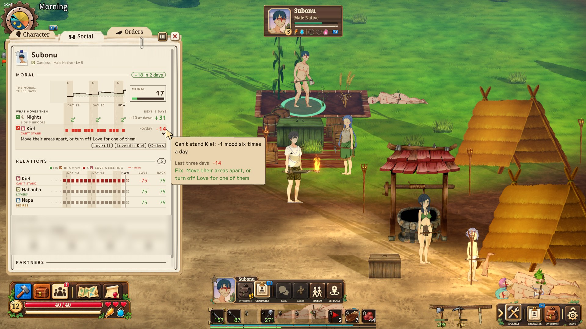
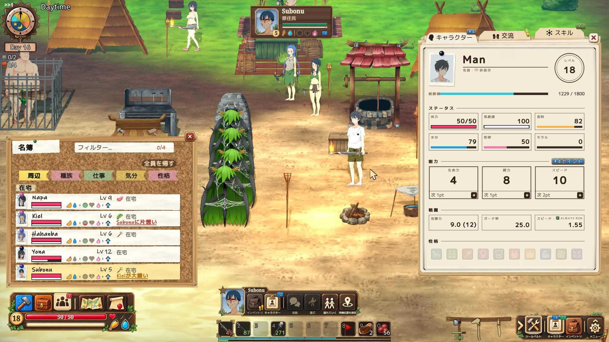

# Island UI in play

A tour of what Island UI changes, with clips. [← Back to the README](README.md)

## Yours is always yours

In Mad Island, one window shows your bag and the bag of whoever you clicked, one status window
serves you both, and an item you use while someone is selected goes to them.

Island UI gives everything its own place: **you** on the right, **what you are dealing with**
in the middle, **what is around you** on the left. Using an item is always on you; to give
it, you drop it on them.

 

## One piece

<table><tr>
<td width="42%">

The parts lead to each other. A name on a sheet opens that person; a mood problem names its
cause and takes you to where you fix it; a row in the roster, a pin on the map or the plaque
of a fight makes its person your target.

*One take: the roster shows who is unhappy, the sheet says why, Orders and Set place fix it.*

</td>
<td>

<!-- clip U1: one unbroken take - the roster shows who is unhappy, the sheet says why, Orders and Set place fix it -->
https://github.com/user-attachments/assets/307e04cd-e04f-4d95-890f-60e2188e6c3a

</td>
</tr></table>

## The screen

<table><tr>
<td width="42%">

Every window has a home and never covers another: on the **left** what is around you
(crafting, the storage nearby and your people, as tabs of one window), in the **middle** what
you are dealing with, on the **right** you.

`Space` closes everything, and a press that closes something doesn't also attack.

</td>
<td>

<!-- clip T1: opening and closing windows - each to its place, the dock buttons pressing, the sheet dragged to the left and back -->
https://github.com/user-attachments/assets/0a580a09-d2c8-425d-bb87-ce7eea47735f

</td>
</tr></table>

<b>More about the screen</b>

- Your sheet and your target's are two sheets, each in its place.
- The target's sheet slides to the free left side and back; the left column's windows keep one height, so nothing jumps.
- One search, the same in crafting, storage and the roster.
- The dock's buttons show which windows are open.
- The fight's plaque has the top centre; the game log runs in the left column.
- The item card stands beside the cell, never over it.
- Small switches, like always-run, live on your sheet, out of the way.
- A painted HUD in walnut and ivory: the vitals panel with a live portrait, a dock of icon buttons, two EXP rails.
- Every one of the game's own keys can be remapped; clashes are outlined and named.
- `F6` quick-saves to the slot you loaded, with a small "Saved" line instead of the game's popup.
- World hover names no longer show through windows.

## A target

The base game has no target: a click walks you there and opens a menu that closes when you
move. Island UI holds the person or thing you are dealing with until you let go.

<table>
<tr>
<td width="42%">

- `Tab` targets without walking - people, enemies, bodies, chests and props alike.
- A dock of everything you can do with them; out of reach, a key says how much closer to walk.
- The marker never loses them: off screen it points the way, indoors it stands on the door.

</td>
<td>

<!-- clip T2: Tab to a villager without walking, the dock's keys, Talk in its bubble, then they walk off and the marker points the way -->
https://github.com/user-attachments/assets/55970f95-bf2e-4a62-9231-4344579f0871

</td>
</tr>
<tr>
<td width="42%">

The marker shows at a glance how they are - and how they feel about you. Dance for her and
its love icon fills; then Talk opens in a bubble at her head, and you can still move.

</td>
<td>

<!-- clip T3c: her marker shows how she feels about you - dance for her (8x) and its love icon fills from 10 to 62; then Talk opens in a bubble at her head -->
https://github.com/user-attachments/assets/5a6f3a01-6f20-4f78-bd89-7a45d467d4b2

</td>
</tr>
</table>

<b>More about the target</b>

- A click is still the game's.
- Giving is a drop: drag an item onto the person, and out of reach you walk over first.
- Switch a well or a food store to auto-use, and you drink or eat there by yourself when you need it.
- Follow and Leave work from anywhere.
- A ring on the ground in the colour of what they are to you; the game's pulsing outline is off.
- A far well or food box shows Drink and Eat, greyed until you are in reach.
- Props can be targeted too: a sign, a bed, a wreck - with their readings, like a well's water or a building's wear, and Repair while it is a wreck.
- Move, Scale, Edit and Remove rise from one Manage key; entries other mods add to the game's menu appear on the dock, in their own words.
- A gift goes one at a time, so you can hand items round; someone who can't take it says so, and the item stays in your hand.

## Your village

You see a village, not a list of numbers. The roster shows everyone you employ, wherever they
are, with what is wrong in a word. Click someone and their marker tells you at a glance:
hungry? unhappy? how do they feel about you?

When something is wrong, the sheet says why, and how to fix it: mood over three days, a lane
for everything that moves it, warnings before a grudge or a missing bed costs anything - and
a button for each step of the fix.

 

<table><tr>
<td width="42%">

**Place your people where you like.** Set place shows what a spot gives - food, water, a
house, the neighbours and how they will get on - before you choose it. You never need to know
the rules first: Island UI shows you which ones matter, when they matter.

</td>
<td>

<!-- clip T3b: Set place - choosing a spot while the food, wells, house and neighbours light up, arcs to who will love or clash -->
https://github.com/user-attachments/assets/f23b0259-c55c-47f8-acae-0ac47f73403d

</td>
</tr></table>

<b>More about your village</b>

- Who is close to revolt, and how many are unhappy.
- Who meets whom, and how love moves between them, drawn as arcs in the world.
- What each person likes and dislikes, and what it is worth.
- One Orders page for everything a villager does.
- Love as the lines the game acts on, not a number in the thousands.
- Family as rows: parents and children, each a link.
- The roster sorts by where they are, kind, job, mood or personality; "Send home" and "All names" act on everyone.
- Character sheets as printed forms with a live passport photo, in front of where the person is.
- Every box on a sheet has a tip with the rule behind it, including tips the game only has in Japanese.
- The love ledger remembers who met whom at each love tick, what it was worth and why - kept in the save.
- A log line warns when someone is close to rebelling; a morning report says who didn't sleep, and why.
- On the map, your favourites as photo pins; a click selects the person.

## No more item juggling

<table>
<tr>
<td width="42%">

Every storage within reach - chests, cages, planters, your people's bags, bodies - in one
window that follows you as you walk. Empty or fill them all in one click.

</td>
<td>

<!-- clip T4a: walking into the base as the chests join the list, then All out and All in, items flying -->
https://github.com/user-attachments/assets/7ebfca48-8d95-4158-9ed5-54b7faaac0a1

</td>
</tr>
<tr>
<td width="42%">

**Crafting follows how you think.** Open it and walk toward your workshop: what you can make
unfolds as benches and materials come in reach. One window for every bench, crafting from
your bags and everything around you.

</td>
<td>

<!-- clip T4b: crafting opened away from the workshop, then walking toward it as the recipes come alive -->
https://github.com/user-attachments/assets/924090e2-1ac1-40d4-9723-418e812f51e9

</td>
</tr>
<tr>
<td width="42%">

Search by who wears it: *"tool female"*, and the bow for Kiel is made and in her hands.

</td>
<td>

<!-- clip T4c: a weapon for Kiel - "tool female" in the filter, the bow crafted, then dropped on her -->
https://github.com/user-attachments/assets/4f025cca-c9a9-40f9-9470-c2780350f1ce

</td>
</tr>
</table>

<b>More about items and crafting</b>

- An action bar that holds what you use, and only that: the game's storage moved into your backpack, beside your own bag.
- Your bag and the Shared Bag work as one.
- Mark a favourite once, and nothing ever sweeps it away.
- Hang your tools on the belt: chop with a sword in hand and the axe comes out for the job.
- Loot fills your own bag too, and every pickup flies into its cell.
- A missing material is one click from its own recipe, and back.
- Each recipe says how many you can make, and why not when you can't.
- Your bags stay open while you walk.
- `Ctrl`+click moves a stack to where it belongs; `Shift`+click splits it in a small dialog.
- Hover something wearable and the loadout slot it would fill lights up - in red if they can't wear it.
- Compact lists only the filled slots; chips per kind of container choose hidden, shown or stack.
- The crafting window is a blueprint sheet: what you can make in colour, the rest as line drawings.
- The action bar keeps a row for each character you play, and greys a binding when you run out.

## The whole fight

<table>
<tr>
<td width="42%">

You see the whole fight: who is in it, who is on you, and who is coming from off screen.
Friend or foe by colour, from what each has shown you; your own people's health over their
heads. What you see of a stranger follows your Observation skill.

</td>
<td>

<!-- clip T5: a fight - the plaque, markers over the enemies, one off screen on the edge, one on you glowing red, a follower's green bar -->
https://github.com/user-attachments/assets/78249f6a-6879-49ef-94a4-d87f5836d124

</td>
</tr>
<tr>
<td width="50%">

<!-- clip T5-raid: a raid on the base - every attacker marked, red rings, the plaque -->
https://github.com/user-attachments/assets/9c8cb36c-f95a-47fa-83f0-4e6eb3f136aa

</td>
<td width="50%">

<!-- clip T5-boss: a boss fight - the plaque marks the boss and stays on it -->
https://github.com/user-attachments/assets/a33bcd9a-4edc-4d40-b2c0-c94b078f0f38

</td>
</tr>
</table>

<b>More about fights</b>

- Hover anyone to see their health.
- All out loots every body in reach.
- The plaque names the fight's first enemy, bosses first, with "+N in combat" for everyone else; click it to target them.
- A downed enemy stays a few seconds on the plaque, marked Slain or Fainted.
- Settings keep markers on your people, on enemies or on the neutral outside a fight too.

## The small touches

<table><tr>
<td width="42%">

- Giving is a drop: drag it onto them.
- Auto-use: you eat and drink by yourself.
- The tool belt: the axe comes out for the tree.
- A missing material is one click from its recipe, and back.
- One word finds it in every chest around you.
- Rename anyone in place.
- Hold a modifier: the cursor says what the click will do.
- Inside a house: the marker waits on the door.
- `Space` closes everything.

</td>
<td>

<!-- clip S1: the reel - nine small touches, a few seconds each, a caption under each -->
https://github.com/user-attachments/assets/f48a462b-4206-4932-88ef-41df04d5d3d9

</td>
</tr></table>

## On top

Island UI also tells you what the game keeps to itself:

- Every item card says how to get it: where it is found, what drops it, who trades it.
- Story choices say what they lead to; spoilers stay hidden until you click.
- Every number on the sheets explains the rule behind it.
- In seven languages.

And the extras: a readable cursor, every key rebindable, quick save on `F6`, a drop-down console.

 

**[Every feature, big and small →](FEATURES.md)**

[← Back to the README](README.md)
